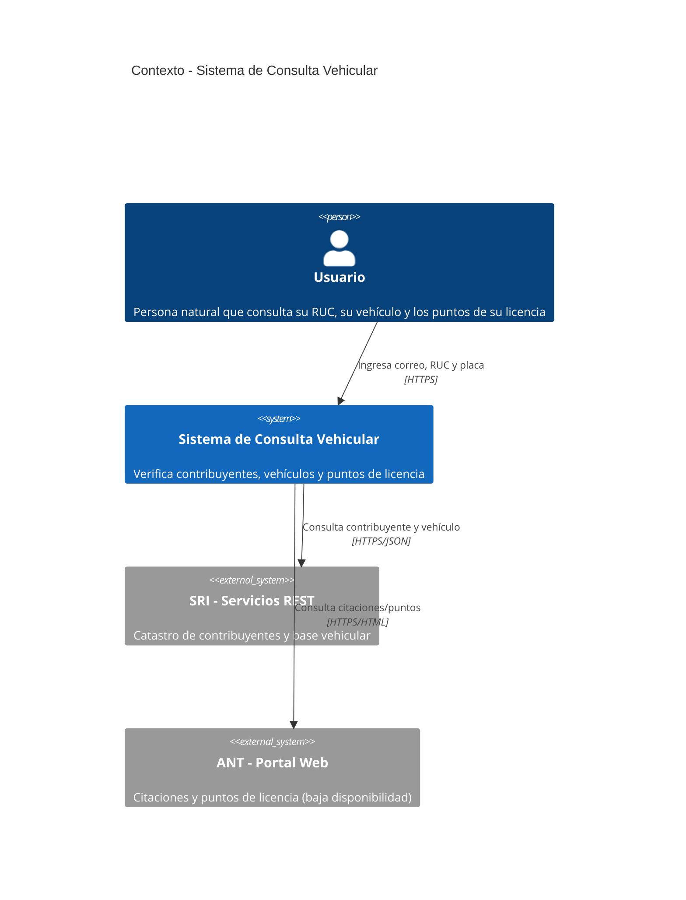
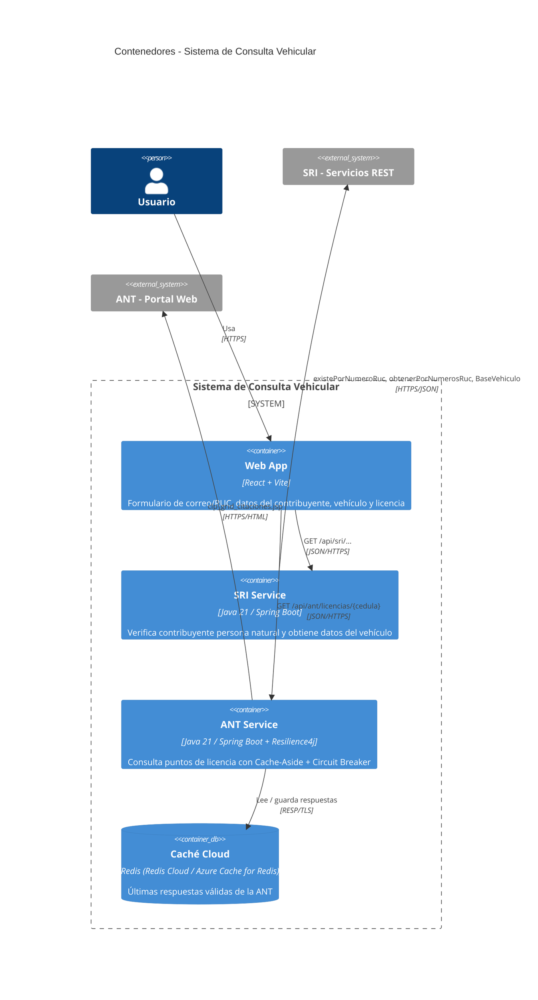
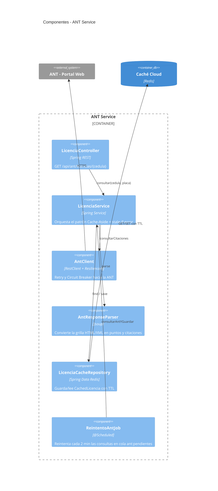
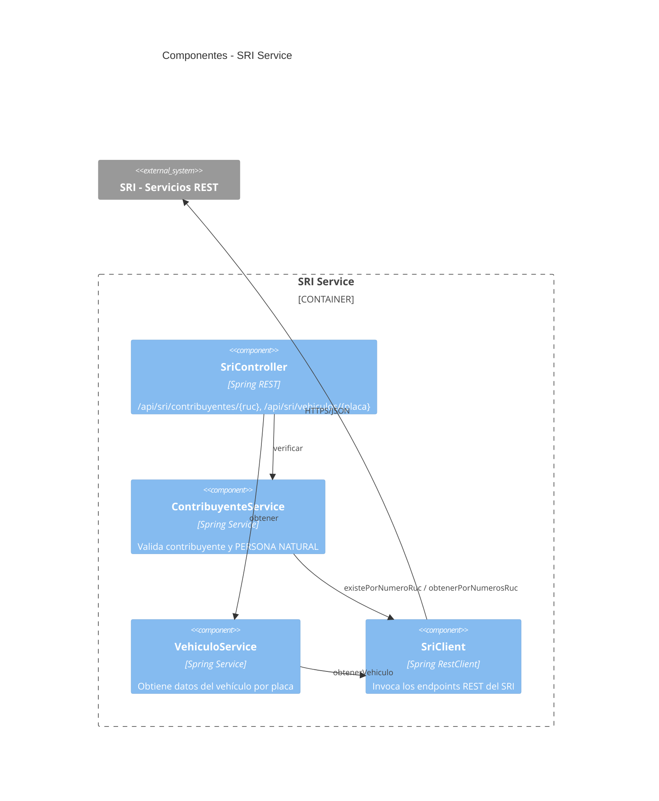

# Modelo C4 – Sistema de Consulta Vehicular

Diagramas en sintaxis Mermaid C4 (se ven directamente en GitHub). El mismo modelo está publicado en IcePanel.

## Nivel 1 – Contexto

## Nivel 2 – Contenedores

## Nivel 3 – Componentes del ANT Service

## Nivel 3 – Componentes del SRI Service

## Patrón de resiliencia para la ANT

**Cache-Aside con respaldo (stale-if-error) + Retry + Circuit Breaker**

1. `LicenciaService` busca primero en Redis. Si la copia tiene menos de `fresh-ttl` (30 min) se devuelve sin tocar la ANT → `origen = CACHE`.
2. Si no hay copia reciente se llama a la ANT (`AntClient`, con Retry ×2 y Circuit Breaker).
3. **Cada respuesta adecuada** (HTTP 2xx, con contenido, sin página de error) se guarda en Redis con TTL de 7 días → `origen = ANT`.
4. Si la ANT falla o el circuito está abierto, se devuelve la última copia válida → `origen = CACHE_RESPALDO`, con aviso al usuario.
5. Si tampoco hay copia en caché, la consulta se encola en `ant:pendientes`, `ReintentoAntJob` la reintenta cada 2 min hasta guardarla y se responde `503`.
